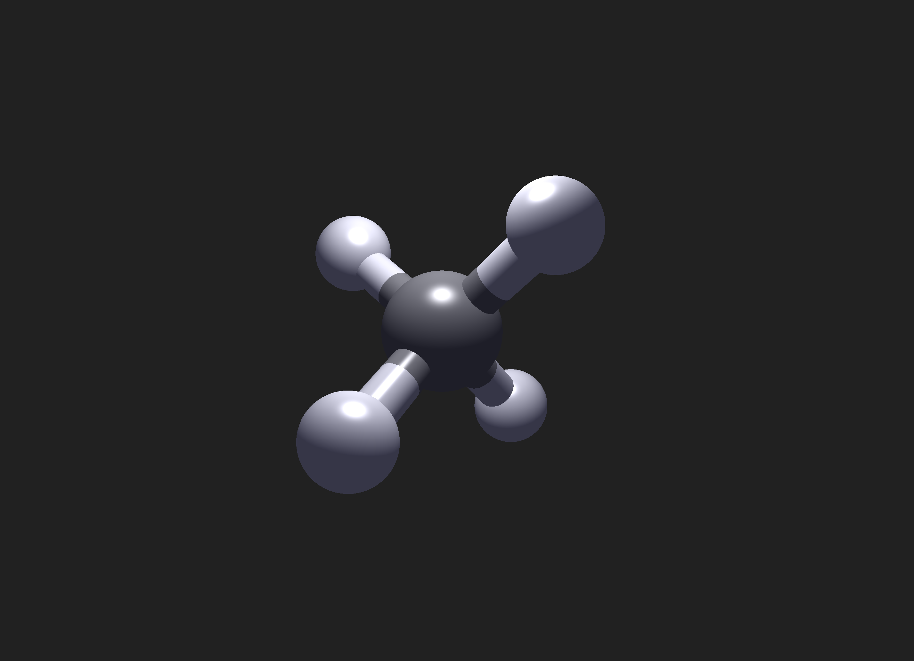

# [MolViz](https://github.com/dirdr/molecular_visualization/edit/main/README.md)

Simple OpenGL molecular visualization, capable of reading protein data bank files using imposter based rendering.
This application has been written for the Scientific visualization course of the MIRI master in the _Facultat d'Informàtica de Barcelona_.

## Features

- Sphere and Cylinders are rendered through imposters.
- Perspective camera
- Zoom
- Shoemake arcball model rotation
- OpenGL instancing for billboards
- Phong shading
- Silhouete
- Dynamic scaling of the molecule
- Halfway bonds coloring

> [!WARNING]
> The program is not capable of deducing the bonds of pdb files without `CONECT` records.

## Usage

You must have rust installed on your computer to start this program, see [rust website](https://www.rust-lang.org/).

A version of OpenGL 4.1 + must also be available.
This application has only been tested on an apple silicon machine with OpenGL 4.1 Metal and GLSL 410 core, althrough it must be possible to run it with more recent versions.

You can either test the program with the provided pdb files (see [pdb folder](./resources/pdb/), or provide your own file.
The files need to be placed inside the pdb folder, see above.

1. Clone the repo
2. Start the application

```sh
cargo run --release -- --file <FILE>
    Options:
  -f, --file <FILE>
  -h, --help         Print help
  -V, --version      Print version
```

## Browser build

The browser build runs the Rust PDB parser, molecule preparation, camera, and
arcball controls through WebAssembly. A WebGL 2 backend renders the same sphere
and cylinder imposters as the desktop application. Both backends embed the GLSL
files in `resources/shaders`; the browser backend adapts their version header to
GLSL ES 3.00. There is no separate JavaScript implementation of the molecule or
camera logic.

Install [wasm-pack](https://rustwasm.github.io/wasm-pack/installer/), then run:

```sh
rustup target add wasm32-unknown-unknown
wasm-pack build --release --target web --out-dir web/pkg --no-pack --no-default-features --features web --locked
python3 -m http.server 8000
```

Open `http://localhost:8000/web/?molecule=methane`. Replace `methane` with the
name of any PDB file in `resources/pdb`. Desktop builds continue to use Glium
through the default `desktop` feature.

To embed the viewer, serve `web/viewer.js` alongside the generated `web/pkg`
directory and call it with a canvas and PDB text:

```js
import { mountMolecule } from "./viewer.js";

const response = await fetch("/molecules/methane.pdb");
if (!response.ok) throw new Error("Could not load molecule");
const dispose = await mountMolecule(canvas, await response.text(), onError);
```

The host selects the file; the viewer does not add a file picker or controls.
`mountMolecule` handles pointer rotation, wheel zoom, keyboard input, resizing,
and WebGL context restoration. Call the returned `dispose` function when removing
the canvas to release listeners and GPU resources. The lower-level
`MoleculeViewer` Wasm class is also available for hosts with their own input loop.

### Verification

```sh
cargo check --locked --all-targets
cargo check --locked --no-default-features --lib
cargo check --locked --target wasm32-unknown-unknown --no-default-features --features web --lib
cd web
npm ci
npx playwright install chromium
npm test
```

The browser tests render every supplied molecule and check rotation, zoom,
context restoration, invalid input, and actual GPU output.

## Control

| Control          | Key           |
| ---------------- | ------------- |
| Rotate Molecule  | `Left-Click`  |
| Toggle Silhouete | `Right-Click` |
| Zoom             | `Mouse-Wheel` |

## Showcase




